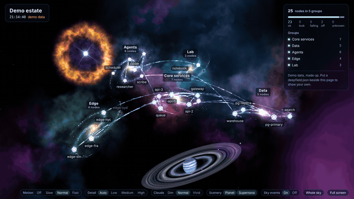
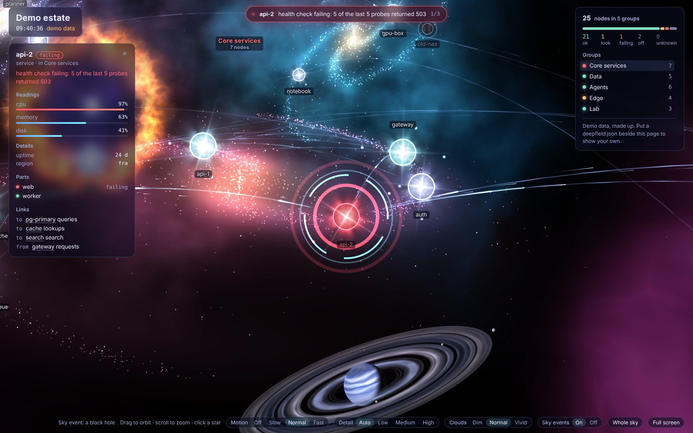
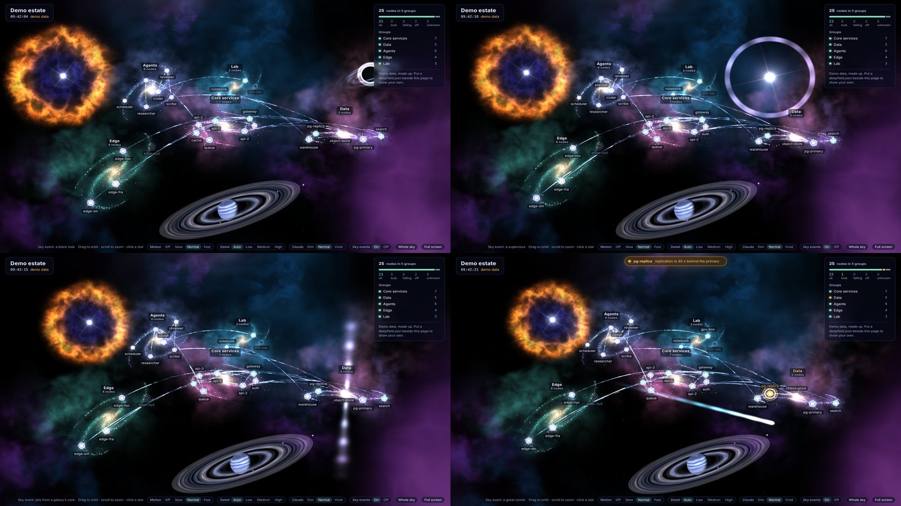
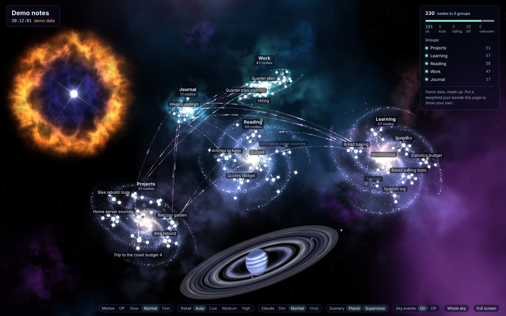
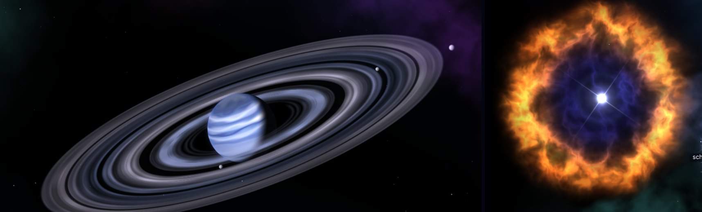
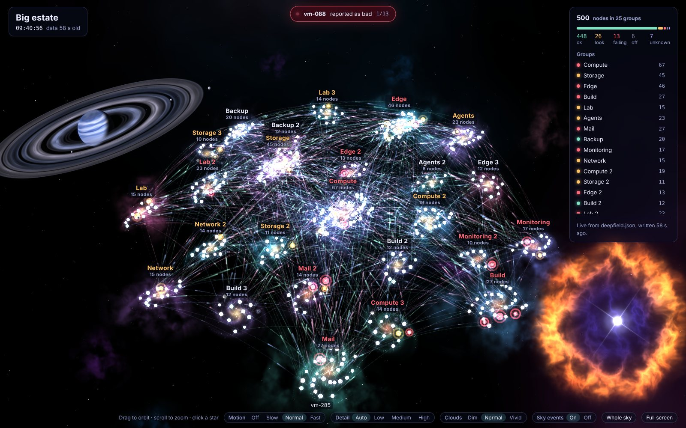

# Deepfield NOVA

**Your servers, AI agents or notes, drawn as a living galaxy.** One HTML file. No build step, no dependencies, no account, no tracking.



**[Live demo](https://efp7s999.github.io/deepfield-nova/)**: runs in your browser on made-up data, nothing to install. There is a second one for [linked notes](https://efp7s999.github.io/deepfield-nova/?demo=notes).

- **It reads from across the room.** Healthy is calm. Trouble turns amber or red and moves.
- **It is one file.** `index.html` is the whole thing: hand-written WebGL2, about 140 KB, and it works offline.
- **Your Obsidian vault as a web of notes.** One command, below. Each note gathers round the notes it links to.
- **Your own data in one prompt.** Open this folder in Claude Code or another coding agent, say what you run, and it writes the adapter for you. Two adapters are already here: one for a folder of Markdown notes, one for the machine it runs on.
- **It grows with you.** 512 nodes, 32 groups and 1,024 links as shipped, and one line raises that.
- **It keeps to itself.** The page talks to nothing but its own data file.

Each thing you care about is a star. Groups of them are spiral galaxies. Data moving between them is a stream of light. A star that needs a look turns amber and sends out slow rings; one that is failing turns red and flickers. Click any star and the camera flies to it and shows what is known about it.



Now and then something happens in the sky that has nothing to do with your data: a black hole opens, a star goes supernova, a great comet crosses.



## What stands for what

| In your data | In the sky |
|---|---|
| a node (server, VM, container, agent, note) | a star, sized by its weight, coloured by its state |
| a group (cluster, hypervisor, project, folder) | a spiral galaxy holding its stars |
| a link (requests, replication, hand-offs) | a stream of light flowing from one star to another |
| a node's parts (services, disks, tools) | moons going round the star |
| an alert | the pill at the top of the page |
| new data arriving | a front of light running down every link |

## Try it

```sh
git clone <this repository> deepfield-nova
cd deepfield-nova
python3 -m http.server 8080
```

Open <http://localhost:8080>. With no data file, the page shows a made-up estate and says so in the top left. Things go wrong and recover in it every couple of minutes, so you can see every state.

To see a real file drawn, copy the sample: `cp deepfield.sample.json deepfield.json`. Its timestamp is fixed, so the page will flag it as stale. That is the page doing its job.

Opening `index.html` straight from disk also works, but browsers will not let a page on `file://` read a file beside it, so you will only ever see the demo that way.

## Show your own data

The page draws one file, `deepfield.json`. Anything that can write that file can drive the sky. The format is in [SCHEMA.md](SCHEMA.md); the smallest valid file is one node with an id.

### 1. With one prompt

Open this folder in [Claude Code](https://claude.com/claude-code) or another coding agent and say what you want to see:

```text
Connect this dashboard to [my Proxmox host and the VMs on it]. Follow AGENTS.md.
```

[AGENTS.md](AGENTS.md) tells the agent how: read-only access, a mapping it shows you first, an adapter in `adapters/`, a validated file, and no secrets in the output. More examples, and a version for a plain chat window, are in [PROMPT.md](PROMPT.md).

### 2. With an adapter that is already here

#### An Obsidian vault, or any folder of Markdown notes

```sh
node adapters/markdown-vault.mjs ~/path/to/vault --watch 30
```



Notes become stars and gather round the note they link to most, so every hub sits in a burst of its own notes. Folders become galaxies, links become threads, a note's headings become its moons. Notes that link to nothing drift at the rim, and notes untouched for six months go cold. Point at a note to light up its links; click it to fly in.

- **Links it follows:** `[[Note]]`, `[[Note|shown text]]`, `[[Note#Heading]]`, `[[Note^block]]`, `![[Note]]` and `[text](folder/note.md)`. A link finds its note by path, by file name, or by an alias in the note's front matter, the way Obsidian does.
- **Tags:** from front matter and from `#tags` in the text. `--group tag` makes galaxies from tags, not folders; a flat vault that uses tags gets that without asking.
- **Size:** the 500 best-connected notes are drawn (`--max`). For more, raise `LIMITS` in `index.html`; see "Big estates" below.
- **Left out:** `.obsidian`, `.trash` and other hidden folders, Excalidraw drawings, and any folder you name with `--ignore "Templates,Archive"`.
- **Notes not written yet:** a link to a note that does not exist is listed in the readout and nothing more. `--strict` turns such notes amber.
- **It only reads.** Nothing in the vault is ever changed.

The output holds your notes' titles, paths, tags and headings, never their text. Anyone who can open the page can read that file, so keep the page private if the titles are.

Any other data can ask for the same placement with `"layout": "web"` in the data file.

This machine: processor, memory, disks, uptime.

```sh
node adapters/local-machine.mjs --watch 10
```

Several machines: run the adapter on each, collect the files, and join them. A machine that stops reporting is shown as unknown, never as healthy.

```sh
node tools/merge.mjs --out deepfield.json parts/*.json
```

All of these need Node 18 or newer and nothing else.

### 3. By hand

Write the file from any language. Then check it:

```sh
node tools/validate.mjs deepfield.json
```

The validator says in plain words what will not be drawn and why, and flags anything that looks like a credential.

## Controls

| | |
|---|---|
| Drag | orbit |
| Scroll, or `+` and `-` | zoom |
| Point at a star | its own links brighten and the rest fade |
| Click a star | fly to it and pin its readout |
| Click a galaxy's core or name | fly to that galaxy |
| `Esc` | one step back out |
| `H` or **Whole sky** | back to the overview |
| **Full screen** | for a wall display |
| **Motion** | off, slow, normal or fast |
| **Detail** | auto, low, medium or high |
| **Clouds** | dim, normal or vivid: how bright the gas is behind the stars |
| **Scenery** | two switches: the ringed planet, and the supernova. Click one to remove it, again to bring it back |
| **Sky events** | on or off |

Left alone, the view sways slowly from side to side. After 20 seconds the camera starts a tour: failing stars first, then each galaxy, then the whole sky. Any input stops it.

The choices at the bottom are remembered in that browser.

### If nothing moves

Your system is asking for reduced motion (on Windows this is the *Animation effects* switch under Accessibility). The page honours that by starting still, and says so in the footer. Pick a speed under **Motion** and it runs; it will not ask again.

## Sky events

Every half minute or so, one of seven things happens somewhere in view, clear of your galaxies:

| | |
|---|---|
| a black hole | opens, bends light round its shadow for a quarter of a minute, and goes out with a flash |
| a supernova | a flash far behind everything, and a ragged shell running outward |
| a pulsar | two beams sweeping, a ring for every turn |
| jets | two cones of light out of one galaxy's core |
| a great comet | right across the view |
| a meteor shower | thirty or so, all from one point |
| a storm in the nebula | a patch of the gas flashes |

**They are scenery, not data.** They never use amber or red, they never change a star, and the footer names each one while it lasts. Turn them off with the **Sky events** control, or for good with `events: false` in `CONFIG`.

## Far scenery

Two things sit far behind everything, in whichever corners of the opening view your galaxies leave free:

- **A ringed giant** in the spirit of J1407b, the "Super Saturn". The planet turns, each belt of cloud at its own rate, and carries one great storm round with it. Its rings turn too, the inner lanes faster than the outer ones, with three moons keeping the gaps clear. The planet's shadow falls across the rings and the rings' shadow across the planet.
- **The remnant of a supernova**. It swells and settles about every twelve seconds, its gas streams outward, and the star left at its centre flickers and sends rings of light out through the hollow.



The remnant is orange. Everywhere else on this page warm colour means trouble, so it is kept far off and slow, and it never reacts to data.

Each has its own switch under **Scenery** at the bottom of the page. `scenery: false` in `CONFIG` removes both for everyone, along with the switches.

## Big estates



The page draws up to **512 nodes, 32 groups and 1,024 links** as shipped. As the numbers grow, galaxies grow to hold their stars, links are drawn fainter so they stay threads, and pointing at a star picks its own links out of the crowd.

Those numbers are one line in `index.html` (`LIMITS`) and can go to 2,048 nodes, 64 groups and 4,096 links. `AGENTS.md` has a "Scaling up" section an agent can follow: what to group, what to gather into one node, and what raising each limit costs. A prompt as short as *"I have about 900 VMs across 14 hosts, make it all fit"* is enough.

## Settings

The `CONFIG` block at the top of the script in `index.html`:

| Setting | Default | Meaning |
|---|---|---|
| `dataUrl` | `deepfield.json` | where the data file is, relative to the page |
| `pollMs` | `10000` | how often to fetch it |
| `title` | empty | overrides the data file's own title |
| `demoWhenMissing` | `true` | show the demo if there is no data file; `false` shows an empty sky and says why |
| `tour`, `tourEverySec` | `true`, `16` | the idle camera tour |
| `pauseOnBlur` | `false` | also stop drawing when the window loses focus |
| `nebula` | `1.0` | sky brightness, 0 to 1.5 |
| `gpuBudgetMs` | `6` | above this GPU time per frame, the scene drops to a lower resolution; 0 turns that off |
| `staleAfterSec` | `120` | data older than this is flagged as stale |
| `events` | `true` | sky events; `false` removes them and their control does nothing |
| `eventEverySec` | `[22, 48]` | the gap between sky events, picked at random between the two |
| `scenery` | `true` | the ringed giant and the supernova remnant in the far background |
| `demo` | `'estate'` | which made-up data shows when there is no file: `'estate'` (servers and agents) or `'notes'` (linked notes). Adding `?demo=notes` to the address picks the second |
| `layout` | `''` | empty: place stars as the data file asks. `'arms'` or `'web'` forces one for every file |

## What it asks of your machine

It is hand-written WebGL2 with no libraries, and built to be left running:

- eleven draw calls a frame, twelve while a sky event is on, whatever the size of the estate;
- the nebula is painted once at start-up. After that the sky and the clouds, the two costliest things on the page and the two softest, are drawn at half size off screen and enlarged: a quarter of the pixel work for the same picture;
- a ceiling on pixels at every Detail level, so a 4K screen does not get four times the work of a 1080p one (auto never draws more than 4.2 million);
- what cannot be seen is not sent: moons too small to show, comets too faint, the empty corners of the scenery. With a great many links, each carries fewer comets and is drawn finer;
- all motion is computed on the GPU from the clock, and the frame loop makes no garbage;
- a refresh of the data rebuilds only what changed: the galaxies' loose stars and the clouds are left alone unless a group comes or goes;
- drawing and fetching both stop while the tab is hidden;
- with Motion off, it draws one still frame per data change;
- on **Detail: auto**, if the GPU is struggling the scene drops to 75% and then 50% resolution and says so in the footer.

| Detail | Resolution | Most pixels | Sky and clouds drawn at | Galaxy stars | Far stars | Clouds, at most | Frames a second |
|---|---|---|---|---|---|---|---|
| low | 60% | 1.3 million | 40% | 3,000 | 1,200 | 10 | 30 |
| medium | 80% | 2.6 million | 50% | 6,000 | 1,800 | 20 | 60 |
| high | 100% | 8.3 million | 60% | 9,000 | 2,400 | 32 | 60 |
| auto | 100%, lowered under load | 4.2 million | 50% | 9,000 | 2,400 | 32 | 60 |

High also paints a finer sky on a large screen. Low is the one for a machine that runs warm or a display that is on all day.

It has been tested in Chromium. It has not been profiled across a range of real graphics hardware, so treat the load guard and the Detail control as the safety nets they are.

## Privacy

- The page makes no network requests except for the data file. No fonts, no analytics, no CDN.
- Everything in the data file is escaped before it is shown.
- **Anyone who can open the page can read `deepfield.json`.** Do not put tokens or passwords in it, and think about hostnames, addresses and note titles before putting the page on the open internet.
- `deepfield.json` is in `.gitignore`, so your own data does not get committed by accident.

## Browser support

Any browser with WebGL2: current Chrome, Edge, Firefox and Safari. Without it, the page falls back to a flat picture with the same labels and panels.

## What is in here

```text
index.html               the whole dashboard
deepfield.sample.json    an example data file
SCHEMA.md                the data format
AGENTS.md, CLAUDE.md     instructions for coding agents
PROMPT.md                prompts to copy
adapters/                markdown-vault.mjs (Obsidian and other Markdown notes), local-machine.mjs
tools/                   validate.mjs, merge.mjs
```

## Credits

The code, shaders and documentation here were written by [Claude](https://claude.com), Anthropic's AI model.

## Licence

MIT. See [LICENSE](LICENSE).
